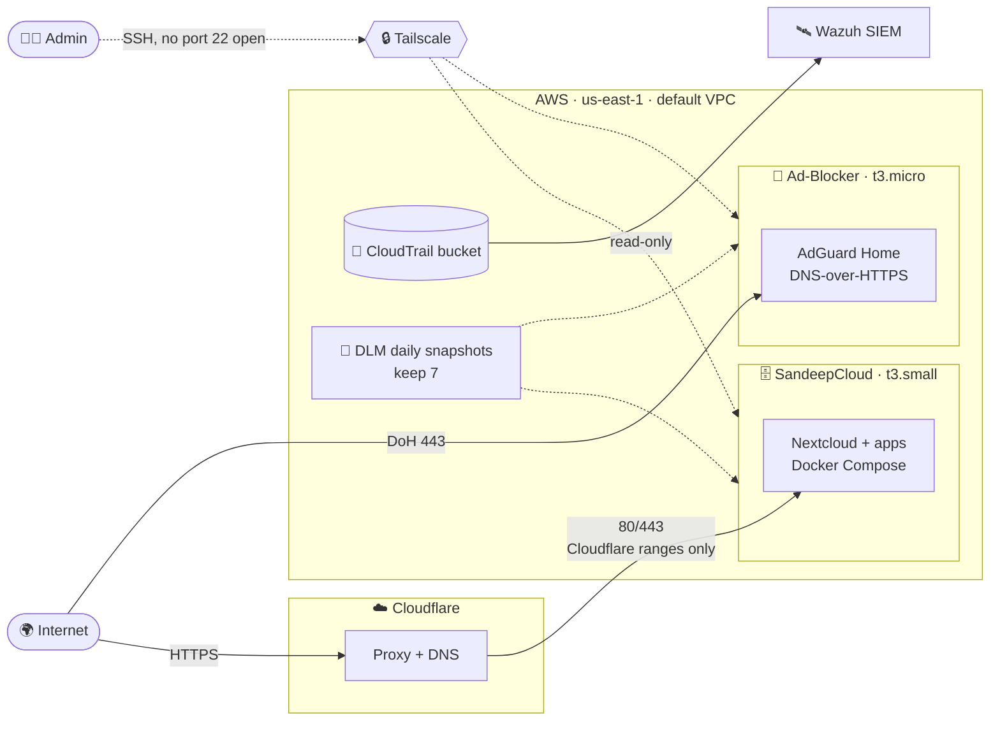
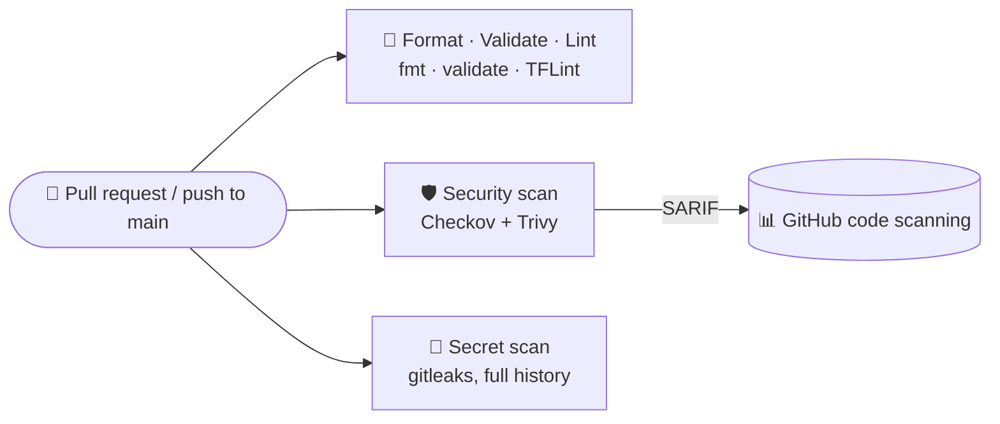

<div align="center">

# 🏗️ SandeepCloud IaC

**A live, self-hosted AWS stack (a Nextcloud/apps server and a public DNS-over-HTTPS ad-blocker) adopted into Terraform without a single resource being replaced, then scanned on every pull request.**

[](https://github.com/pokharelsandeep333-commits/SandeepCloud-IAC/actions/workflows/iac.yml)


</div>

---

## ✨ At a glance

| | |
|---|---|
| 🎯 **Goal** | If the stack ever has to move, rebuild it from code in **about an hour**, not a weekend |
| 📦 **Managed** | 58 live AWS resources: 2 EC2 servers, Elastic IPs, security groups, CloudTrail and its bucket, EBS snapshot policy, budget, alarms |
| 🔁 **Adopted, not rebuilt** | Every resource was brought in with `import` blocks until `terraform plan` said **`No changes.`**, then refactored into a module with `moved` blocks, still `No changes.` |
| 🧩 **Modular** | One `web-host` module, called once per server, each with its own on/off switch |
| 🛡️ **Scanned** | `fmt` · `validate` · TFLint · Checkov · Trivy · gitleaks on every PR, with findings in GitHub code scanning. **Zero open findings**: every one was fixed or accepted in code with a reason |
| 🔐 **No secrets in code** | No passwords, keys or tokens in `.tf`, tfvars, outputs or state. Personal values stay in a gitignored `terraform.tfvars` |

## 🗺️ Architecture



- **SandeepCloud** accepts web traffic **only from Cloudflare's published IP ranges** (30 rules: 15 ranges × ports 80 and 443).
- **The Ad-Blocker** is public on 80/443 by design: public DNS-over-HTTPS is the product. Its dashboard is IP-locked in nginx on the host.
- **Neither security group opens port 22.** SSH runs only over Tailscale.
- **CloudTrail** covers every region and validates its log files. A Wazuh SIEM reads the bucket as its own read-only IAM user, managed outside this repo.

## 🔄 CI pipeline



| Job | What it runs | Fails the build? |
|---|---|---|
| 🎨 **Format · Validate · Lint** | `terraform fmt -check`, `init -backend=false` + `validate` for each root module, TFLint with the AWS ruleset | ✅ Yes |
| 🛡️ **Security scan** | Checkov (Terraform + this workflow) and Trivy, uploaded to code scanning, then a 🚦 gate | ✅ Yes, on any finding not skipped in code with a reason |
| 🔐 **Secret scan** | gitleaks across the **whole git history** | ✅ Yes |

**How the pipeline is locked down**

- 📌 Every action is pinned to a **full commit SHA**, and only to releases at least a week old.
- 🔑 `permissions: {}` at the top. Each job gets `contents: read`, and only the scan job gets `security-events: write`.
- 🧾 Trivy and gitleaks come from their release tarballs, **checked against SHA-256 hashes written in the workflow** rather than through third-party actions. (In March 2026 `trivy-action`'s tags were hijacked; see [GHSA-69fq-xp46-6x23](https://github.com/aquasecurity/trivy/security/advisories/GHSA-69fq-xp46-6x23).)
- 🚫 No `pull_request_target`, no cloud credentials in CI, and **`apply` never runs in CI**.

Each run writes a summary table per job to the run page.

## 🛡️ Security controls in the code

| Control | Where |
|---|---|
| 🧷 `prevent_destroy` + `ignore_changes = [ami, user_data]` on both servers: a new AMI can never replace a live box | `modules/web-host` |
| 🚪 No ingress on port 22; the module's input validation refuses it | `modules/web-host` |
| 🔐 IMDSv2 required, encrypted gp3 root volumes, termination protection | `modules/web-host` |
| 🛑 `allowed_account_ids`: Terraform refuses to run against any other AWS account | `providers.tf` |
| 🗄️ Remote state in S3: versioned, encrypted, public access blocked, TLS-only, S3-native locking | `bootstrap/` |
| 📜 Multi-region CloudTrail with log-file validation, bucket locked to the trail | `envs/prod/account.tf` |
| 🤖 **AI agents are read-only in AWS.** They write code and review plans, but can't read state or apply. A human runs every `apply` | [`CLAUDE.md`](CLAUDE.md) |

## ⚠️ Accepted risks

Phase 3 took the first scan's **25 findings (Checkov 16, Trivy 9)** to zero: **7 fixed** and **18 accepted**. The rule was to fix what's free and accept what costs money or adds risk, with a reason. Each accepted risk is a `#checkov:skip=ID:reason` or `#trivy:ignore:ID` line next to the resource. Skipped checks are kept out of code scanning, so this table is where they're recorded.

**Fixed:** versioning on the CloudTrail bucket (deleted logs recoverable for 30 days), cleanup of unfinished uploads, and descriptions on every security group rule.

| Check | Resource | Why it's accepted |
|---|---|---|
| `CKV_AWS_35` / `AVD-AWS-0015`, `CKV_AWS_145` / `AVD-AWS-0132` customer-managed KMS key | CloudTrail, trail bucket, state bucket | SSE-S3 already encrypts at rest. A key costs $1/month, and the Wazuh reader would need `kms:Decrypt` in a stack managed outside this repo |
| `CKV_AWS_18` / `AVD-AWS-0089` access logging | trail bucket, state bucket | Needs a second bucket. CloudTrail already records bucket-level changes |
| `CKV_AWS_144` cross-region replication | trail bucket, state bucket | Doubles storage. Wazuh keeps an off-account copy of the trail, and state is rebuilt from code in a new account |
| `CKV2_AWS_62` event notifications | trail bucket, state bucket | Nothing consumes them. Wazuh polls the bucket |
| `CKV2_AWS_10` / `AVD-AWS-0162` CloudWatch Logs | CloudTrail | Ingestion is billed. Wazuh is where the logs get analysed |
| `CKV_AWS_252` SNS topic | CloudTrail | Nothing consumes per-file notifications |
| `CKV_AWS_126` detailed monitoring | both servers | About $2.10/instance/month. The status-check alarms already get free 1-minute metrics |
| `CKV2_AWS_41` no IAM role | both servers | Neither server calls AWS APIs. No role means no AWS credentials on the box to steal through IMDS |
| `CKV_AWS_260` port 80 open to all | Ad-Blocker | The HTTP-to-HTTPS redirect and Let's Encrypt HTTP-01 renewal |
| `AVD-AWS-0104` unrestricted egress | both servers | Updates, Docker pulls, Tailscale, Let's Encrypt and upstream DNS all need it. Port-restricted egress gets tried in the fire drill, where a wrong rule can't break a live server |

## 📁 Repository layout

```text
.
├── 🧱 bootstrap/            S3 state bucket (local state, applied once per account)
├── 🌐 envs/prod/            Root module for the live account: backend, imports, both servers
├── ☁️ envs/cloudflare/      Root module for the Cloudflare zone (DNS + Email Routing), state in R2
├── 🧩 modules/web-host/     One web server: instance, EIP, key pair, security group, rules, alarms
├── 🧩 modules/cloudflare-zone/  DNS records and Email Routing rules for one zone
├── ⚙️ .github/workflows/    iac.yml: the CI pipeline above
└── 🔍 .tflint.hcl           TFLint config (Terraform + AWS rulesets)
```

## 🚀 Running it

Plans and applies run **locally from PowerShell**, never in CI. The step-by-step commands live with each root module:

- 🧱 [`bootstrap/README.md`](bootstrap/README.md): create the state bucket (once per account)
- 🌐 [`envs/prod/README.md`](envs/prod/README.md): init against the S3 backend, plan, apply

```powershell
terraform init "-backend-config=backend.hcl"   # backend.hcl and terraform.tfvars are gitignored
terraform plan -out tfplan                     # read every -/+ and destroy line before applying
terraform apply tfplan
```

Each server can be built alone: set `enable_sandeepcloud` or `enable_adblocker` to `false` in `terraform.tfvars`.

## 🧭 Roadmap

| Phase | What | Status |
|---|---|---|
| 0 | 🧰 Inventory, tooling, repo, state bucket | ✅ Done |
| 1 | 📥 Import all 58 resources → **`No changes.`**, then the module refactor | ✅ Done |
| 2 | 🔄 CI: fmt, validate, TFLint, Checkov, Trivy, gitleaks → code scanning | ✅ Done |
| 3 | 🩹 Triage findings: 25 → 0 (7 fixed, 18 accepted with reasons); the build now fails on any new one | ✅ Done |
| 4 | 👁️ GuardDuty + AWS Config + alerts | ⏸️ On hold |
| 5 | 🖥️ Server layer: cloud-init, compose files, encrypted off-site backups, restore runbook | 🚧 Next |
| 6 | 🔥 Fire drill: rebuild from zero, restore, time it, tear it down | 📋 Planned |

---

<div align="center">
<sub>Built by <a href="https://github.com/pokharelsandeep333-commits">Sandeep Pokharel</a> · Terraform · AWS · GitHub Actions</sub>
</div>
